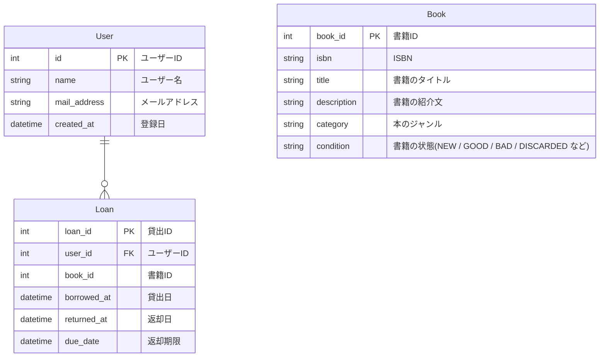
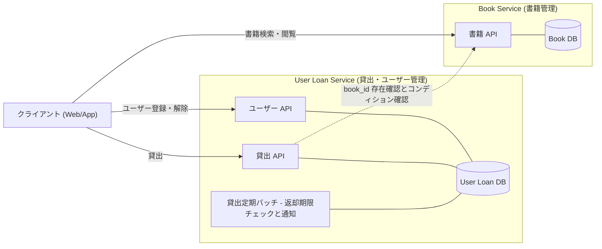

# 仕様
- ユーザーは本を借りることができる
- 借りられる本の冊数は普段は3冊だがキャンペーン期間中は10冊になる
- 貸出可能な本の在庫がない場合は本を借りることができない
- ユーザーは返却期限までに本を返却する必要がある。返却期限を過ぎた場合は通知がとぶ
- ユーザーは自身を登録することができる
- ユーザーは自身の登録を解除することができる
- ユーザーはメールアドレスの設定を変更することができる
- ユーザーは現在の自身の貸し出し状況を確認することができる
- ユーザーは本のタイトル、ジャンルで検索することができる
- 管理者は本を入荷した場合は本を登録することができる
- 管理者は本の状態が悪い場合は書庫から登録を解除することができる
- 貸出中の場合は本の登録を解除することはできない

# ER図

# システム構成

